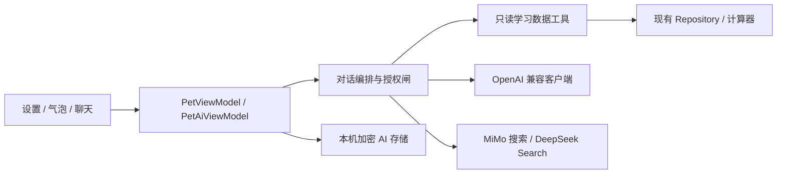

# 宠物 AI 首发设计

2026-11-11，用户逐项确认后授权实施，分支 `codex/pet-llm-integration`，基线 v2.0.2 / 66。初期实施未包含发布；用户随后明确授权直接发布更新供手机测试，本次发布为 v2.1.0 / 67。

## 已确认的体验

- “我的”只保留一个宠物设置入口，详细设置归入互动、API 与联网、人格、记忆与数据。
- MiMo、DeepSeek 预设地址和模型，填 Key 即可使用；自定义 OpenAI 兼容供应商支持地址、Key、模型名。可保存多组配置，选择当前使用的一组。
- 主动气泡和连续文字聊天并存；点击宠物打开半屏聊天，可展开全屏。保留拖动和课程触摸穿透。首发不含语音、图片和核心数据写操作。
- 可编辑宠物名字、称呼和自由人设。聊天记录及可管理的长期记忆留在本机，可查看、修改、删除、关闭。
- 课表、考试、日程、成绩、学分进度、学籍分别授权，默认不授权，只在问题需要时读取。密码、学校会话、云账号凭证不进入 AI 上下文。
- 仅课表可见且 RESUMED、没有弹层时主动请求；切页、后台、翻周和弹层取消请求。搭话间隔、热点刷新频率独立配置。
- MiMo 使用官方内置搜索；DeepSeek 使用官方 Search API。搜索来源与聊天模型独立，自定义模型可配单独的 DeepSeek 搜索 Key。显示来源、发布时间或获取时间，搜索失败不冒充实时信息。
- API 配置后以生成内容为主；未配置、断网或失败保留离线兜底。课次、考试时间、GPA、加权与学分仍复用本地计算规则。

## 架构与取舍

### ADR 1：手机直连供应商

不增加服务端代理：用户自带 Key，手机直接调用所选地址，部署和费用边界清楚。HTTPS 地址经校验，禁用自动跨地址重定向，不记录请求正文、Key 和原始错误响应。自定义模型若不支持工具调用，明确提示能力限制，不静默上传全部学习数据。

### ADR 2：独立加密存储

AI 配置、Key、对话和记忆存入 `noBackupFilesDir`，AndroidKeyStore AES-GCM 加密、AtomicFile 原子替换。比修改核心 Room / 云快照协议更容易隔离风险；不改变 Room v7。密钥或密文异常显示可恢复的错误，不静默明文保存或覆盖旧文件。存储有消息、记忆和文本长度边界。

### ADR 3：按工具请求读取，严格授权

模型通过只读工具指定数据类别和日期范围，应用再校验当前授权。数据带时间和业务口径，复用 WeekResolver、CourseVisibility、TodoPlanner 及成绩计算器。权限或供应商变化时取消旧请求并开启新会话；历史回复和记忆保留数据来源标记，禁止重新发送已撤销授权的内容。

### ADR 4：网络与界面分离

客户端处理流式文本、工具调用片段、来源与错误；编排器限制工具轮数、上下文和并发。短气泡与完整聊天使用同一人格和授权。主动请求跟随课表生命周期取消，聊天请求单独管理，关闭聊天或退后台停止；迟到响应不能覆盖新配置。热点按时间缓存，搜索查询不拼接私人学习数据。用户可关闭自动记忆；记忆工具仅保存偏好和明确约定，不保存凭证或瞬时成绩。

## 页面与失败状态

沿用现有 Material 3、主题与间距。设置入口显示当前宠物和模型状态；详细页分组导航，输入 Key 默认遮罩，提供连接测试与模型列表加载。聊天提供输入、停止、重试、新会话、历史和来源链接；半屏可展开，键盘和列表保持可用。缺 Key、授权不足、搜索未启用、限流、超时、存储损坏分别提示，核心课表始终可用。

## 验证

JVM 覆盖地址及响应校验、SSE / 工具调用、权限与历史隔离、上下文日期/隐藏/统计、搜索来源、限额和取消；设备覆盖单入口设置、供应商配置保存、人格/记忆编辑、半屏展开与真实触摸、关闭和后台取消，并回归现有 7 类交互。运行全量 JVM、JS、Lint、debug 和 release R8。真实供应商测试需要用户在 App 内配置 Key，不能读取用户其他工具的密钥代替。

官方参考（2026-11-11 核对）：
- [MiMo 首次调用](https://mimo.mi.com/docs/en-US/quick-start/first-api-call)
- [MiMo 联网搜索](https://mimo.mi.com/docs/en-US/quick-start/usage-guide/text-generation/tool-calling/web-search)
- [DeepSeek 首次调用](https://api-docs.deepseek.com/)
- [DeepSeek Search / Fetch](https://api-docs.deepseek.com/guides/search/)
